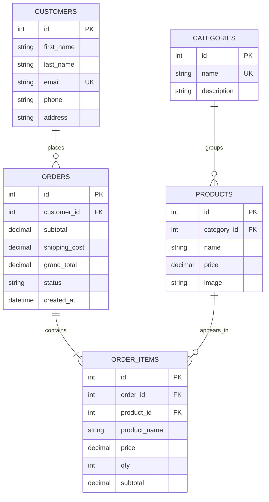

# Simple Tech Shop

A React shopping cart backed by a PHP API and MySQL database running in XAMPP.
Products are loaded from MySQL, cart quantities and totals update in the
browser, and checkout saves an order and its items to the database.

## Set up XAMPP

1. Start **Apache** and **MySQL** in the XAMPP Control Panel.
2. For a new database, import `xampp/shop-api/schema.sql` in phpMyAdmin. This
   creates `shop_db`, its tables and relationships, and the sample products.
   For a database from an earlier exercise, import
   `xampp/shop-api/order_confirmation_migration.sql` once. If that database
   predates the checkout form, import `checkout_migration.sql` first.
3. Copy the `xampp/shop-api` folder into XAMPP's `htdocs` directory. For a
   standard Windows installation, the destination should be
   `C:\xampp\htdocs\shop-api`.
4. Add your real Bakong KHQR merchant image at `public/khqr.png`. The checkout
   confirmation will show a setup notice until that file exists. Do not use a
   sample QR for real payments; the app does not verify payment automatically.
5. If your MySQL credentials differ from XAMPP's default `root` user with no
   password, update the connection settings in `shop-api/db.php` or set the
   `SHOP_DB_HOST`, `SHOP_DB_USER`, `SHOP_DB_PASSWORD`, and `SHOP_DB_NAME`
   environment variables for Apache.
6. Confirm the API responds at `http://localhost/shop-api/get_products.php`.

The API allows requests from Vite at `http://localhost:5173` and
`http://127.0.0.1:5173`. If Vite uses a different address or port, add that
origin to the allowlist in `shop-api/db.php`.

## Run the React app

```sh
npm install
npm run dev
```

By default, the app calls `http://localhost/shop-api`. Set `VITE_API_URL` in a
`.env` file if the API is hosted at another URL, for example:

```text
VITE_API_URL=http://localhost/shop-api
```

Use the **Products** page to add items, then open **Cart** to change quantities
or remove products. Checkout collects and validates the customer's name,
email, phone, and address. Choose standard delivery (free) or express delivery
($10); the order summary updates the grand total. Checkout uses Bakong KHQR;
the confirmation page displays your merchant QR image. After placing the order, a
confirmation page displays its ID, customer, date, products, total, and status.
Prices and shipping fees are calculated by the API before the order is saved.

## Database ERD



`ORDERS.id` is shown to customers as `ORD-` followed by a zero-padded ID.
`ORDER_ITEMS` stores the product name and price at purchase time so an order
remains understandable if a catalog item changes later.
